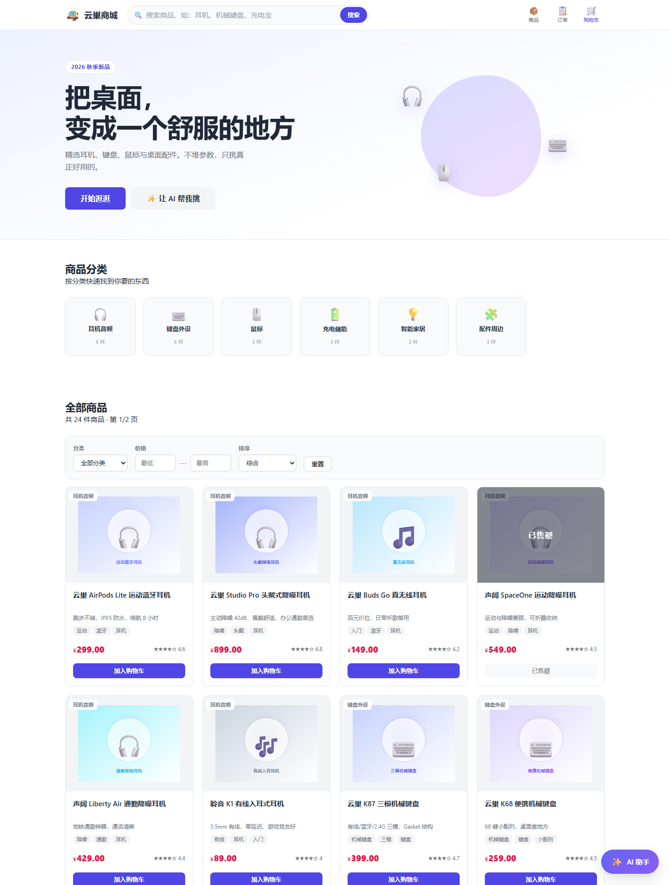
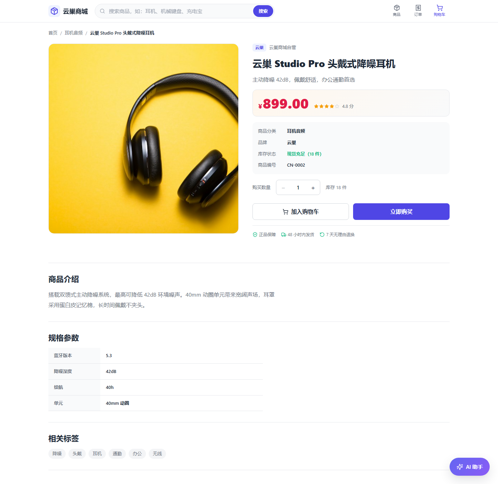
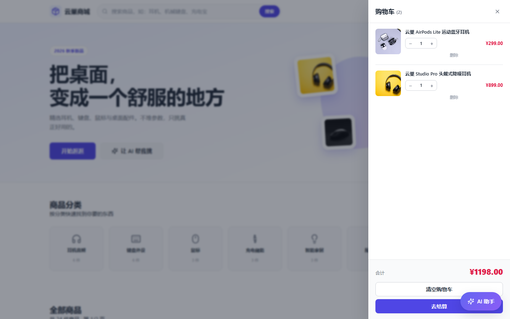
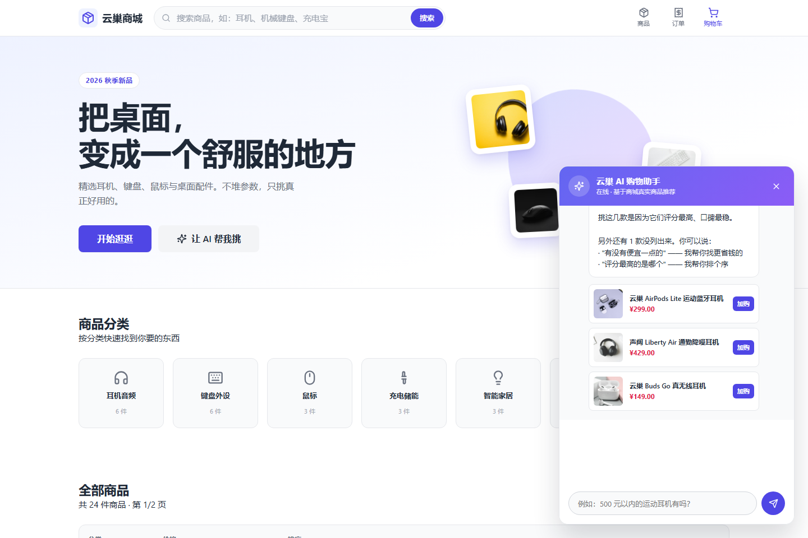
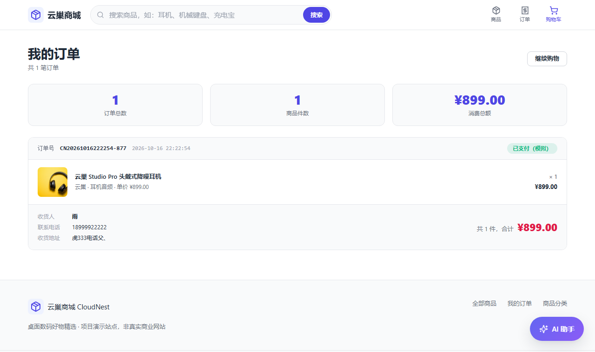
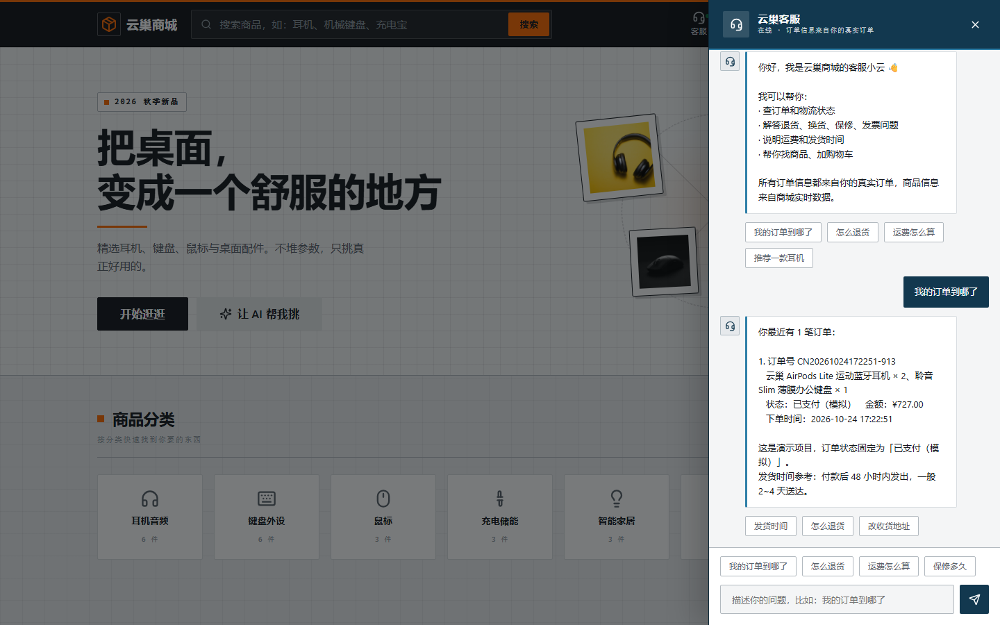
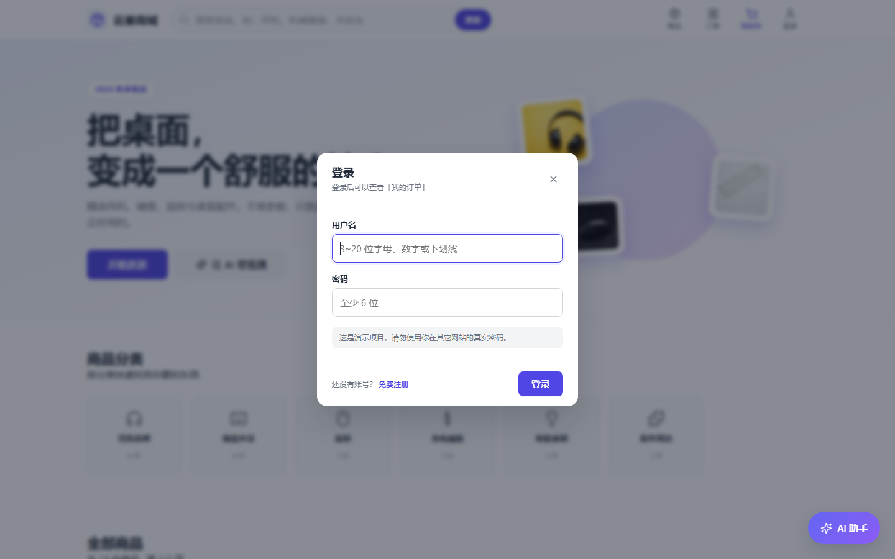
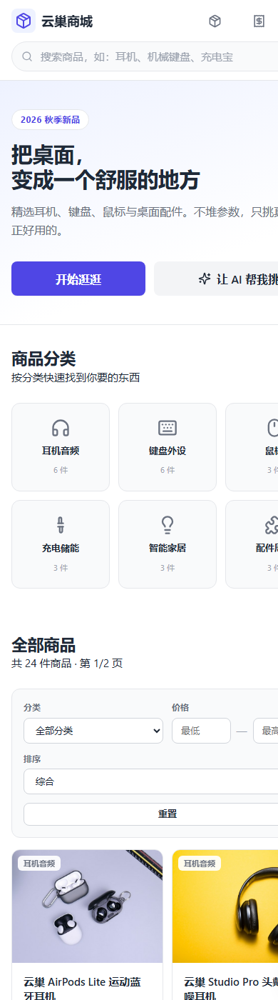

# 云巢商城 CloudNest

一个卖桌面数码用品的小型购物网站：注册登录、浏览商品、搜索筛选、看详情、加购物车、下单、查订单，另外带一个能聊天的 AI 购物助手和一个 AI 客服。

- 前端：原生 HTML + CSS + JavaScript，**没有用框架**
- 后端：Node.js + Express，数据存在本地 JSON 文件里，**不用装数据库**
- 在线 Demo：<https://cloudnest-shop.onrender.com>　演示账号 `demo` / `demo123456`

> 免费实例闲置会休眠，第一次打开可能要等半分钟，这是正常的。

---

## 先跑起来

需要 Node.js 18 或更高版本。

```bash
cd cloudnest-shop
npm install     # 只有第一次需要
npm start       # 启动后在浏览器打开 http://localhost:3000
```

看到下面这行就成功了：

```
云巢商城 CloudNest 已启动
商城首页:  http://localhost:3000/
```

> 两个新手最常踩的坑：
> 1. 必须通过 `http://localhost:3000` 打开，**不要直接双击 `index.html`**
>    （那样地址是 `file:///`，没有后端，商品会一直显示"加载中"）
> 2. `npm start` 之后终端窗口不能关，关掉服务就停了

常用命令：

| 命令 | 作用 |
|---|---|
| `npm start` | 启动服务 |
| `npm run dev` | 启动服务，改后端代码后自动重启 |
| `npm test` | 跑全部测试（要先 `npm start`） |
| `npm run eval` | 跑 AI Agent 的 12 条评估用例（要先 `npm start`） |

---

## 功能

**逛商品**

- 首页：导航栏、为你推荐（评分最高的 4 件）、6 个分类入口、商品列表、搜索框、购物车入口
- 搜索：按名称、简介、标签、品牌搜，输入停顿 400ms 才发请求（不会每敲一个字请求一次）
- 筛选：按分类、价格区间筛选，可排序
- 商品详情：图片、名称、价格、介绍、分类、库存、规格参数、加购按钮、同类推荐

**购物车**

- 点导航栏购物车图标，从右侧滑出抽屉
- 加商品、删商品、改数量、一键清空
- 自动算每件商品小计和总价
- 存在浏览器里，刷新不会丢

**下单**

- 填收货人、手机号、地址，提交后生成订单号并弹出结果
- 订单包含：编号、商品、数量、单价、总价、创建时间、状态（模拟支付）

**用户**

- 注册、登录、退出，登录状态保持 7 天
- 加购物车和下单必须登录，浏览不需要

**AI 购物助手**（右下角）

- 按预算和需求找商品、多轮追问、组合购买比价
- 能帮加购和下单，但都**必须先确认**

**AI 客服**（顶部）

- 答售后政策（运费、退换货、保修、发票）
- 查你的真实订单
- 帮忙找商品、加购

**适配**

- 电脑、平板、手机都能看；320px ~ 2560px 实测没有横向滚动条
- 支持系统深色模式

---

## 截图

| 首页 | 商品详情 |
|---|---|
|  |  |

| 侧拉购物车 | AI 购物助手 |
|---|---|
|  |  |

| 订单页 | AI 客服 |
|---|---|
|  |  |

| 登录弹窗 | 手机端 |
|---|---|
|  |  |

---

## 项目结构

```
cloudnest-shop/
│
├── server/                 后端
│   ├── app.js              入口：中间件、挂路由、托管前端页面
│   ├── store.js            数据层：查商品、建订单、参数校验
│   ├── auth.js             注册登录、密码加密、会话
│   ├── knowledge.js        客服知识库（运费、退换货等）
│   ├── routes/             四组接口：商品 / 订单 / 用户 / 客服
│   └── data/
│       └── products.js     24 个商品 + 6 个分类
│
├── web/                    前端
│   ├── index.html          首页
│   ├── product.html        商品详情页
│   ├── orders.html         订单页
│   ├── css/
│   │   ├── reset.css       清掉浏览器默认样式
│   │   ├── variables.css   颜色、字号等变量
│   │   ├── layout.css      页面骨架 + 响应式断点
│   │   ├── components.css  按钮、卡片、抽屉、弹窗
│   │   ├── theme-mech.css  工业化主题（最后加载，删掉这行就回旧风格）
│   │   └── pages/          各页面自己的样式
│   └── js/
│       ├── api.js          接口封装（所有请求都走这里）
│       ├── utils.js        工具函数（格式化、防抖、转义）
│       ├── cart.js         购物车状态管理
│       ├── auth.js         登录状态管理 + 登录弹窗
│       ├── components.js   通用组件 + 全局事件
│       ├── agent.js        AI 购物助手
│       ├── support.js      AI 客服
│       └── home.js / product.js / orders.js   三个页面的逻辑
│
├── tools/                  测试和开发脚本
│   ├── test-*.js           8 个测试脚本
│   └── eval-agent.js       AI Agent 效果评估
└── docs/screenshots/       截图
```

---

## 接口

所有接口返回一样：`{ "code": 0, "message": "ok", "data": ... }`
`code` 为 0 表示成功，其它值表示失败，失败原因在 `message` 里。

| 方法 | 地址 | 说明 |
|---|---|---|
| GET | `/api/products` | 商品列表 |
| GET | `/api/products/:id` | 商品详情 |
| GET | `/api/categories` | 分类列表 |
| POST | `/api/orders` | 下单（必须登录） |
| GET | `/api/orders` | 我的订单（必须登录） |
| GET | `/api/orders/:id` | 单笔订单（只能看自己的） |
| POST | `/api/auth/register` | 注册 |
| POST | `/api/auth/login` | 登录 |
| POST | `/api/auth/logout` | 退出 |
| GET | `/api/auth/me` | 当前登录用户 |
| GET | `/api/support/faq` | 客服知识库 |
| GET | `/api/support/my-orders` | 客服查我的订单 |

`/api/products` 可以带这些参数：

| 参数 | 说明 | 示例 |
|---|---|---|
| `keyword` | 关键词，匹配名称、简介、标签、品牌 | `?keyword=耳机` |
| `category` | 分类 | `?category=audio` |
| `tags` | 标签精确筛选，逗号分隔，要同时具备 | `?tags=运动,防水` |
| `minPrice` / `maxPrice` | 价格区间 | `?maxPrice=500` |
| `sort` | `price_asc` / `price_desc` / `rating` | `?sort=price_asc` |
| `page` / `pageSize` | 分页 | `?page=2` |

---

## 前端是怎么跟后端打交道的

所有请求都走 `web/js/api.js` 里的 `request()` 一个函数：

```js
async function request(path, options) {
  // 1. 把对象转成 JSON 字符串，并告诉后端"我发的是 JSON"
  if (config.body && typeof config.body !== 'string') {
    config.body = JSON.stringify(config.body);
    config.headers['Content-Type'] = 'application/json';
  }

  // 2. 带上登录凭证（HTTP 是无状态的，每个请求都要说明自己是谁）
  var token = getStoredToken();
  if (token) config.headers['Authorization'] = 'Bearer ' + token;

  // 3. 发请求
  const response = await fetch('/api' + path, config);

  // 4. 响应是字符串，要 .json() 才能变成对象
  const result = await response.json();

  // 5. 按约定判断成功失败，失败就抛出一个带中文原因的 Error
  if (result.code !== 0) throw new Error(result.message);

  // 6. 页面只关心 data
  return result.data;
}
```

页面里用起来就一行：

```js
const data = await window.api.getProducts({ keyword: '耳机' });
```

出错的地方统一 `try / catch`，把 `err.message` 用 toast 显示出来，不用每个页面自己拼错误信息。

**以"加入购物车"为例，完整走一遍：**

```
点"加入购物车"
  → components.js 捕获点击，拿到商品 id
  → 检查有没有登录，没登录就弹登录框
  → GET /api/products/1  重新拿一次最新价格和库存（怕前端数据过期）
  → 后端查数据，返回 JSON
  → cart.add() 更新购物车
  → 写入 localStorage（刷新不丢）
  → 通知界面重新渲染
  → 角标 +1，购物车抽屉自动滑出来
```

---

## 几个需要能讲清楚的地方

面试官一般会挑这几处问，这里写成大白话，方便自己回顾。

### 1. 密码为什么不存明文

存的是 `crypto.scrypt` 加盐哈希后的结果，不是原密码。就算数据库泄露，别人也拿不到密码。

- **加盐（salt）**：每个用户配一串随机字符一起加密，所以同样的密码存下来也完全不一样，防止拿现成的对照表反查
- **比对用 `timingSafeEqual`**：普通 `===` 是"发现不同立刻返回"，比得快慢会泄露线索；这个函数不管内容如何耗时都一样

### 2. 刷新页面为什么还是登录状态

HTTP 是"无状态"的，后端不记得上一个请求是谁发的，所以要有个凭证在来回传。

```
登录成功 → 后端生成随机 token → 前端存 localStorage
之后每个请求 → 请求头带 Authorization: Bearer <token>
后端收到 → 查这个 token 对应哪个用户
退出登录 → 后端删掉这个 token，立刻失效
```

token 不放 URL 里，因为 URL 会被记进浏览器历史和服务器日志。

刷新页面时，前端看本地有没有 token，有就问一次 `/api/auth/me`"我是谁"，拿到就显示成已登录。

### 3. 为什么前端拦了登录，后端还要再拦一次

前端拦是为了**体验**：直接弹登录框，比让人填完半天表单再报错好。

后端拦才是**安全**：前端拦截用 Postman、curl、甚至浏览器控制台就能绕过。所以 `POST /api/orders` 里会独立判断一次登录状态。

同理，订单归属只认后端从 token 认出来的用户，前端传 `userId` 不生效 —— 否则谁都能冒充别人下单。

### 4. AI 助手的"加购"和"下单"为什么不直接执行

因为这是会花钱的操作。所有写操作都先记在 `pendingAction` 里，AI 说出"我准备把 XX 加入购物车，确认吗"，**用户回"确认"才真正执行**。

说"买了"的时候，加购和下单会写在同一次确认里给你看，点一次确认就都做完 —— 但前提是那两步都已经摆在你面前了。

### 5. AI 读不懂话怎么办（为什么用本地规则）

目前没有接大模型，理解用户说什么用的是本地规则（关键词 + 正则表达式）：

```
"500 元以内的运动耳机有吗"
  → 提取预算 500（数字 + "元以内"）
  → 提取分类 audio（"耳机"）
  → 提取标签 运动（"运动" → 商品标签「运动」）
  → 调用 searchProducts 拿真实数据
```

好处是开箱就能跑、不花钱、断网也能用。坏处是没列举到的说法可能听不懂，比如用中文数字说"五百以内"。

以后要接大模型，只需要改 `web/js/agent.js` 里的 `understand()` 一个函数，其它代码不用动，代码里用 `【TODO-AI】` 标了位置。

---

## AI Agent 效果评估

光说"我的 AI 挺好用"没有意义，所以写了个脚本用它自己测自己：

```bash
npm start        # 另开一个终端
npm run eval     # 跑 12 条用例
```

脚本真的打开页面、发消息、等回复，再从 `window.agent.state.trace` 里读出这一轮调用了哪个工具、传了什么参数、返回了什么，最后统计：

- **任务完成率**：用例级 + 断言级两个口径
- **工具调用参数正确率**：检查入参是否合法（数量是正整数、商品存在、分类合法等）
- **幻觉次数**：推荐给用户的商品，如果不在本次工具返回结果里，就记一次

12 条用例覆盖：单轮查询、搜不到结果、多轮追问（"便宜一点"）、组合约束、预算冲突、模糊输入、超范围请求、提示词注入、未登录写操作、写操作确认、下单闭环、"买第二个"指代。

详细结果每次都会重新生成到 [`docs/agent-eval.md`](docs/agent-eval.md)。

> 因为没接大模型，100% 只代表"这 12 条用例覆盖到的说法"没问题，不代表什么都能听懂。

---

## 测试

```bash
npm test
```

8 个脚本共 290 项检查：

| 脚本 | 项数 | 测什么 |
|---|---|---|
| `test-agent-logic` | 43 | AI 的意图识别、预算和分类提取、组合购买计算 |
| `test-pages` | 29 | 接口结构、搜索筛选、页面元素、下单参数校验 |
| `test-auth` | 32 | 注册登录退出、密码加密、越权检查 |
| `test-runtime` | 40 | 用模拟浏览器跑页面 JS：渲染、购物车、AI 对话 |
| `test-auth-ui` | 39 | 注册 → 登录 → 退出 → 再登录 |
| `test-support` | 56 | AI 客服：知识库、查订单、不编造订单号、防注入 |
| `test-write-tools` | 38 | 两个 AI 的加购下单流程、确认机制 |
| `test-chat-history` | 15 | 对话持久化、上下文裁剪、清空对话 |

后面几个用的是 jsdom，在 Node 里模拟一个浏览器，能真正跑页面的 JS。
这样能测出语法检查测不到的问题，比如变量没定义、元素找不到、函数名写错。

---

## AI Coding Process

这个项目基本是**一边学一边让 AI 写、我自己验证**完成的。用的工具是 DeepSeek Harness。

我的做法很简单：**先想清楚要什么 → 让 AI 写 → 自己跑一遍看 → 不对就带着现象让 AI 改**。

下面挑三件最有代表性的事记下来。写这些不是为了显得会用 AI，而是因为**每一步 AI 都说"改好了"，但大多数问题是我自己验证时才发现的**。

### 案例一：多轮对话"便宜一点"回答"没有了"

**现象**：问"推荐 1000 元以内的机械键盘"，它给出几款；接着问"有没有便宜一点的"，
它回答"没有了" —— 但库里明明有更便宜的键盘。

**怎么查的**：先让它"看起来对"，测试也通过了。后来发现是我的测试写得太松 ——
只检查回复里有没有"便宜"两个字，而"没有更便宜的了"也包含这两个字，所以假通过。

把断言改成**直接比较两轮推荐的商品价格**，要求第二轮确实更低，测试立刻失败，说明真有问题。

**原因有两层叠在一起**：
1. 原来用"上一轮最便宜的价格 × 0.8"当新上限，但那一轮本来就是按价格从低到高排的，
   再打八折比全库最低价还低，必然搜不到
2. 改完还不行。写了个脚本打印内部状态，发现第一轮其实推荐了 **6 个**不是 3 个 ——
   因为调用时传的参数叫 `pageSize`，函数里读的却叫 `limit`，名字对不上被忽略了，走了默认值

**教训**：测试写松等于没测；查问题时打印内部状态，比盯着代码猜快得多。

### 案例二：说"买第二个"，加购的却是第一个

**现象**：这是写 AI 评估脚本时发现的 —— 12 条用例里有一条没过。

**原因**：加购的代码里写死了取推荐列表的第一个：

```js
target = agentState.lastRecommended[0];   // 永远取第一个
```

所以"买第二个"、"帮我把某个型号加入购物车"全都落到第一个商品上。

**怎么改的**：把"判断要买哪一件"单独抽成一个函数，按这个顺序找：
序号（第二个）→ 指代（就那个）→ 在推荐列表里按名字找 → 在整句话里找商品名去搜 → 按品类兜底。
找不到唯一的那件就列出来反问，不替用户决定。

**教训**：代码"能跑"和"答得对"是两件事。这条用例现在留在评估脚本里，以后再改也不会回退。

### 案例三：界面改完，测试全绿，但页面是坏的

**换界面**的时候，测试全部通过，但我在浏览器里一打开就发现三个问题：

1. 屏幕宽 320px 时，顶部 5 个图标按钮加起来比屏幕还宽，页面出现横向滚动条
2. 手机上商品卡片里"价格 + 星级"挤在一起，星星被截掉
3. 系统切到深色模式，按钮变成白底白字，看不见

这三个问题**测试一个都发现不了**，因为测试不看长什么样。

**后来怎么验的**：用浏览器（无头模式）按 320、390、768、1440、2560 五个宽度分别截图，
用眼睛看一遍；再模拟鼠标悬停、深色模式各截一张。改完再截一遍对比。

**教训**：界面的验收标准不是"测试通过"，而是"真的在浏览器里、各种尺寸下看一遍"。

### 我踩过的几个坑（记下来免得再踩）

| 现象 | 原因 | 怎么解决的 |
|---|---|---|
| 服务一启动就崩 | `require('./products')` 路径写错，文件其实在 `server/data/` | 按报错里的 `Require stack` 改路径 |
| 弹窗一打开就全显示出来 | 自己写的 `.modal-mask { display: flex }` 盖掉了 `[hidden]` | 在 reset.css 里加 `[hidden] { display: none !important }` |
| 刷新后购物车一直显示"加载中" | 订阅只在"购物车变化时"才回调，首次打开没人渲染 | 初始化时主动渲染一次 |
| AI 回复里露出一大段 `<svg>` | 聊天气泡会转义，不能放 HTML | 改成纯文本显示"（评分 4.6）" |
| 换商品图后，老订单里的图全破了 | 下单时把图片路径存进了订单（快照），改文件名后旧路径失效 | 写脚本修订单数据 + 图片加载失败统一换成占位图 |

---

## 已知限制

1. **AI 没接大模型**：理解用本地规则，没列举到的说法（比如"五百以内"这种中文数字）可能听不懂
2. **没有流式打字机效果**：回复是一次性出来的，要做真流式得接模型
3. **没有做双模型对比**：需要 Qwen / DeepSeek 的 API Key
4. **对话记录只存在浏览器本地**：换浏览器或清缓存就没了
5. **数据存 JSON 文件**：数据量大了会慢，也不支持多实例同时写
6. **购物车存在浏览器本地**：换设备就没了，真实电商会存到账号下
7. **库存扣减在内存里**：重启服务后库存会还原
8. **模拟支付**：不会真的扣钱
9. **用户系统比较基础**：没有找回密码、改密码、头像上传
10. **没有后台管理**：改商品价格得直接改代码

---

## 关于

个人练习项目，用来熟悉前后端配合、用户系统和 AI 助手的实现方式，不是真实运营的网站。
商品、价格、订单都是演示数据。

AI 助手的理解部分是本地规则实现，没有调用任何大模型 API，所以不产生费用，断网也能用。
