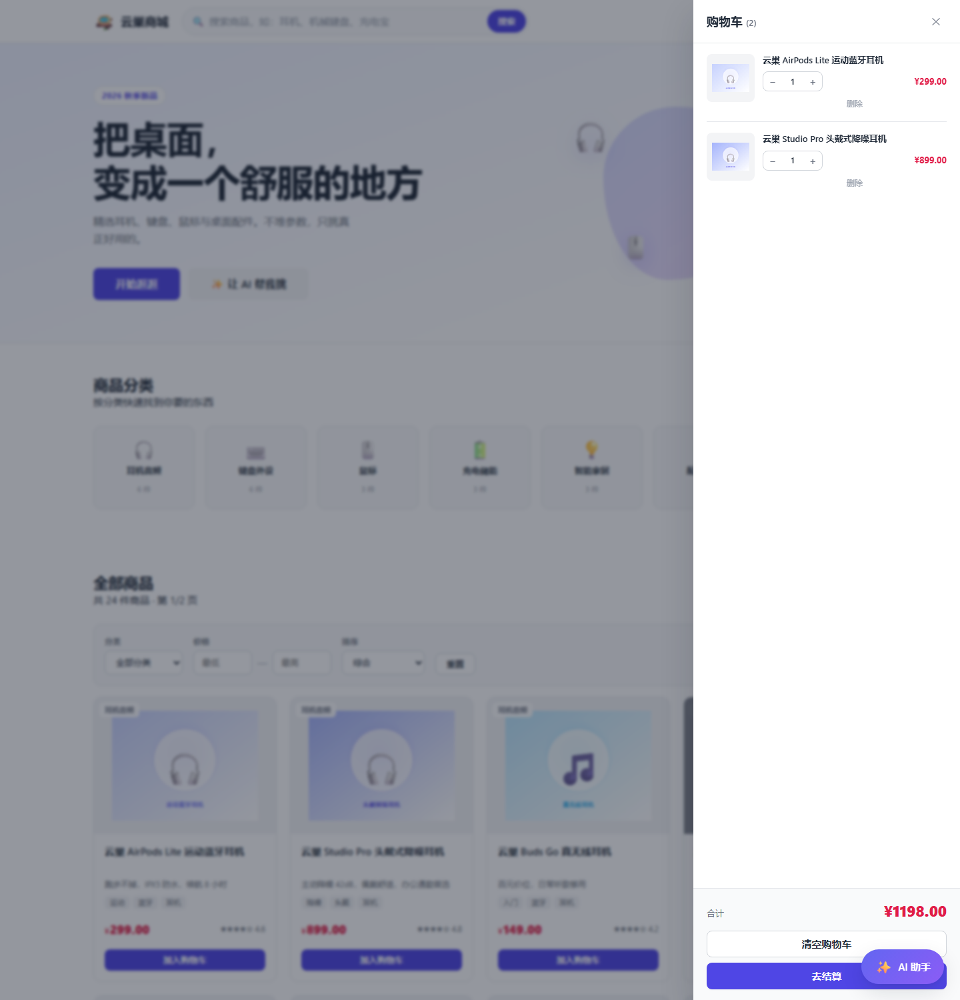
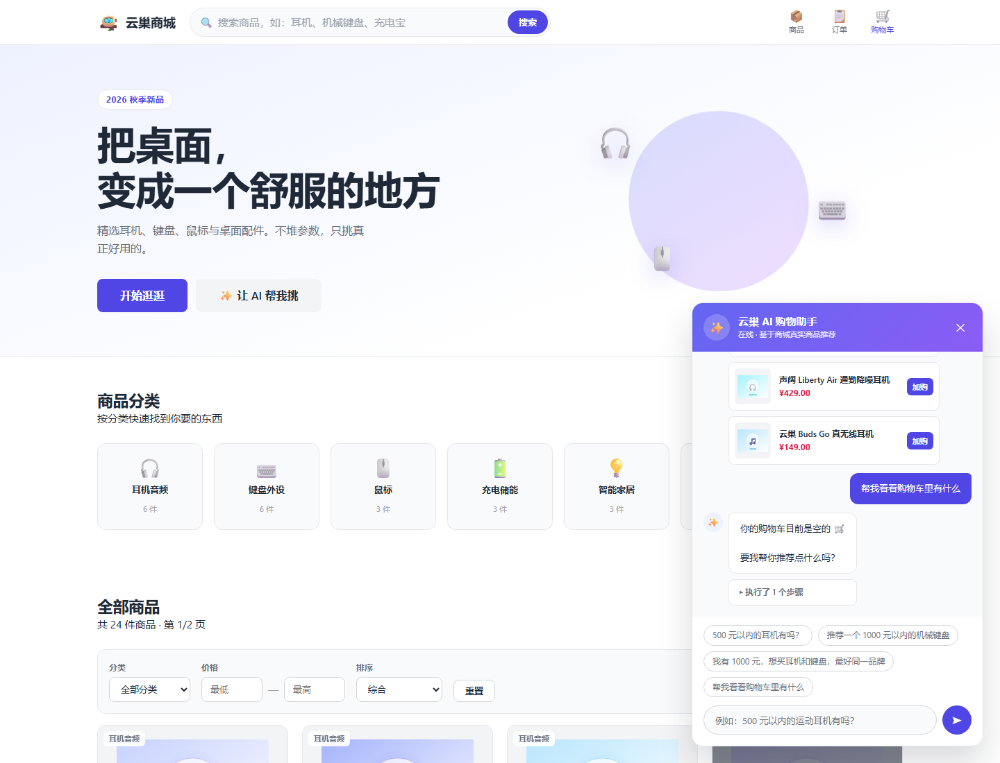

# 🪺 云巢商城 CloudNest

> 26 云屋三面前端（+ AI Agent 开发）项目考核作业
> 一个包含**前端 + 后端 + 商品数据 + 完整购物流程 + AI 购物助手**的商城项目。

---

## 一、项目介绍

云巢商城是一个桌面数码好物精选商城，覆盖「进入商城 → 浏览商品 → 搜索/筛选 → 查看详情 → 加入购物车 → 修改购物车 → 提交订单 → 查看订单结果」的完整链路，并额外实现了一个基于**工具调用（Tool Calling）**的 AI 购物助手。

### 已实现的功能

| 模块 | 功能 | 对应考核要求 |
|---|---|---|
| 首页 | 顶部导航栏 + 图标悬浮效果、Hero 横幅、分类入口、商品列表、搜索入口、购物车入口 | 3.2 |
| 商品列表 | 商品图片、名称、价格、简介、标签、分类、评分 | 3.3 |
| 商品搜索 | 支持商品名称 / 关键词 / 标签 / 品牌搜索，边打字边搜（防抖 400ms） | 3.4 |
| 商品筛选 | 分类筛选 + 价格区间 + 排序（价格升降序 / 评分）+ 分页 | 3.5 |
| 商品详情 | 名称、图片、价格、介绍、分类、库存状态、加入购物车、数量选择、规格参数、同类推荐 | 3.6 |
| 购物车 | **侧拉式**抽屉；添加、删除、改数量、算单项金额、算总额、清空；localStorage 持久化 | 3.7 |
| 下单流程 | 表单校验 → 提交订单 → 模拟支付 → 结果弹窗；订单含编号/商品/数量/单价/总价/时间/状态 | 3.8 |
| 响应式 | Flex + Grid + 媒体查询 + 相对单位 + `clamp()`，支持 50%–250% 缩放 | 3.9 |
| 后端 | 商品列表/详情/分类接口，订单创建/查询接口，参数校验与错误处理 | 四 |
| 数据 | 24 个商品、6 个分类，存储在**后端**，前端通过接口获取 | 五 |
| AI 助手 | 聊天窗口、商品搜索工具、多轮上下文、写操作确认、组合约束求解、鲁棒性与安全防护 | 九（9.1–9.6） |

---

## 二、技术栈

### 前端
- **原生三件套**：HTML5 + CSS3 + JavaScript（ES6+）
- **无框架**：不使用 React / Vue，用原生 DOM 操作和字符串模板渲染
- **CSS 架构**：
  - `reset.css` — 样式重置
  - `variables.css` — CSS 变量（设计令牌）+ 暗色模式
  - `layout.css` — 页面骨架 + 响应式断点
  - `components.css` — 可复用组件
  - `pages/*.css` — 各页面专属样式
- **状态管理**：手写观察者模式（`cart.subscribe()`），购物车数据同步到 `localStorage`
- **API 层**：统一封装 `fetch`，集中处理错误和响应格式
- **图标系统**：内联 SVG（Lucide），详见下方「图标方案」
- **商品图**：真实商品照片（Unsplash 免费图库，可商用）

### 图标方案

**没有使用 emoji，也没有使用图标字体，而是内联 SVG。**

| 方案 | 问题 |
|---|---|
| ❌ emoji（🎧 ⌨️ 🛒） | 每个系统长得不一样；颜色固定不能跟着主题变；和文字对不齐；观感不专业 |
| ❌ 图标字体 CDN | 需要联网才能显示，离线就变成空白方块 |
| ✅ **内联 SVG**（本项目采用） | 不依赖网络、颜色自动跟随、矢量不糊、可精确控制 |

实现方式：`web/js/icons.js` 集中管理所有图标路径，HTML 里写占位符，
页面加载时统一渲染：

```html
<!-- HTML 里只写图标名，清爽好维护 -->
<span data-icon="shoppingCart" data-icon-size="20"></span>
```

```js
// 需要动态生成时，直接调用
window.icons.icon('sparkles', 18)
```

关键点是 SVG 上的 `stroke="currentColor"` —— 描边颜色等于父元素文字颜色，
所以**鼠标悬浮变紫、选中变蓝、暗色模式变白，全部自动生效**，不用写额外样式。

图标来源：[Lucide](https://lucide.dev)（ISC 协议，可免费商用）。

### 后端
- **Node.js + Express 4**
- **分层设计**：`app.js`（入口）→ `routes/`（路由）→ `store.js`（数据层）→ `data/`（种子数据）
- **数据存储**：商品数据在内存中（`data/products.js`），订单持久化到 `data/orders.json`
- **统一响应格式**：`{ code, message, data }`

### 工具与测试
- **Git** — 版本管理
- **jsdom** — 在 Node 里模拟浏览器，跑端到端测试
- **自研测试脚本** — 3 个测试文件，共 81 项断言

---

## 三、快速开始

### 环境要求
- Node.js >= 18
- 无需数据库

### 安装与运行

```bash
# 1. 安装依赖
npm install

# 2. 启动服务
npm start
# 或者开发模式（改代码自动重启）
npm run dev

# 3. 打开浏览器
# http://localhost:3000
```

### 运行测试

```bash
# Agent 纯逻辑测试（不需要启动服务）
node tools/test-agent-logic.js

# 接口 + 页面结构测试（需要先 npm start）
node tools/test-pages.js

# 前端运行时测试：用 jsdom 真正执行页面 JS（需要先 npm start）
node tools/test-runtime.js
```

---

## 四、项目结构

```
cloudnest-shop/
├── package.json
├── README.md
├── .gitignore
│
├── server/                     # 后端
│   ├── app.js                  # 服务入口：中间件、路由挂载、静态资源、错误处理
│   ├── store.js                # 数据层：商品查询、订单创建、参数校验
│   ├── routes/
│   │   ├── products.js         # 商品接口
│   │   └── orders.js           # 订单接口
│   └── data/
│       ├── products.js         # 24 个商品 + 6 个分类的种子数据
│       └── orders.json         # 订单持久化文件（运行时生成）
│
├── web/                        # 前端（静态资源根目录）
│   ├── index.html              # 首页
│   ├── product.html            # 商品详情页
│   ├── orders.html             # 订单页
│   │
│   ├── css/
│   │   ├── reset.css
│   │   ├── variables.css
│   │   ├── layout.css
│   │   ├── components.css
│   │   └── pages/
│   │       ├── home.css
│   │       ├── product.css
│   │       └── orders.css
│   │
│   ├── js/
│   │   ├── icons.js            # 内联 SVG 图标库（Lucide）
│   │   ├── api.js              # 接口封装
│   │   ├── utils.js            # 工具函数（格式化、防抖、防 XSS 等）
│   │   ├── cart.js             # 购物车状态管理
│   │   ├── components.js       # 通用组件 + 全局事件
│   │   ├── agent.js            # AI 购物助手
│   │   ├── home.js             # 首页逻辑
│   │   ├── product.js          # 详情页逻辑
│   │   └── orders.js           # 订单页逻辑
│   │
│   └── assets/products/        # 24 张真实商品照片（JPG，来自 Unsplash 免费图库）
│
└── tools/                      # 开发辅助脚本
    ├── make_images.py          # 生成商品占位图
    ├── test-agent-logic.js     # Agent 逻辑单元测试
    ├── test-pages.js           # 接口与页面结构测试
    ├── test-runtime.js         # 前端运行时测试
    └── trace-refine.js         # Agent 多轮对话状态追踪工具
```

---

## 五、页面效果

### 首页（桌面端 1440px）


包含：顶部导航栏、Hero 横幅、6 个分类入口、筛选工具条、商品网格（售罄商品有遮罩标记）、AI 助手浮窗。

### 商品详情页


包含：面包屑、商品图、名称、价格、分类、品牌、库存状态、数量步进器、加购/立即购买按钮、商品介绍、规格参数表、相关标签、同类推荐。

### 侧拉式购物车



从右侧滑出；支持改数量、删除、查看单项小计与总金额（图中 ¥299 + ¥899 = ¥1198）。

### AI 购物助手



支持多轮对话、商品卡片（带「加购」按钮）、工具调用过程面板（「执行了 N 个步骤」可展开）、快捷问题 Chips。

### 响应式

| 平板（820px） | 手机（390px） |
|---|---|
|  |  |

> 已在 **320px ~ 2560px** 共 8 档视口下验证：`scrollWidth === clientWidth`，
> **无横向溢出**，符合考核 3.9「50%–250% 缩放下布局不错乱」的要求。

---

## 六、接口设计

所有接口统一返回 `{ code, message, data }`，`code === 0` 表示成功。

### 商品

| 方法 | 路径 | 说明 |
|---|---|---|
| GET | `/api/products` | 商品列表，支持搜索/筛选/排序/分页 |
| GET | `/api/products/:id` | 商品详情，不存在返回 404 |
| GET | `/api/categories` | 分类列表（含各分类商品数） |

**`GET /api/products` 支持的查询参数：**

| 参数 | 说明 | 示例 |
|---|---|---|
| `keyword` | 关键词，匹配名称/简介/标签/品牌/描述 | `?keyword=耳机` |
| `category` | 分类 id | `?category=audio` |
| `minPrice` | 最低价 | `?minPrice=100` |
| `maxPrice` | 最高价 | `?maxPrice=500` |
| `sort` | `price_asc` / `price_desc` / `rating` / `default` | `?sort=price_asc` |
| `page` | 页码，从 1 开始 | `?page=2` |
| `pageSize` | 每页条数，默认 12，上限 60 | `?pageSize=24` |

### 订单

| 方法 | 路径 | 说明 |
|---|---|---|
| POST | `/api/orders` | 创建订单（模拟支付） |
| GET | `/api/orders/:id` | 查询订单详情 |
| GET | `/api/orders` | 查询订单列表 |
| GET | `/api/health` | 健康检查 |

**`POST /api/orders` 请求体：**

```json
{
  "items": [
    { "productId": 1, "quantity": 2 },
    { "productId": 7, "quantity": 1 }
  ],
  "customer": {
    "name": "张三",
    "phone": "13800138000",
    "address": "浙江省杭州市西湖区某路 1 号"
  },
  "remark": "工作日送达"
}
```

**后端会校验：** 商品列表非空、收货人姓名非空、手机号格式（`1[3-9]\d{9}`）、地址非空、数量为正整数、商品存在、库存充足。任一不通过即返回 400 和具体原因。

---

## 七、前端如何与后端通信

这是考核第六节要求说明的内容：

1. **前端发请求**：`web/js/api.js` 里的 `request()` 用 `fetch` 请求 `/api/xxx`。因为前后端同源（都在 `localhost:3000`），不需要处理跨域。
2. **后端收到请求**：Express 根据路径匹配到 `routes/products.js` 或 `routes/orders.js` 里的处理函数。
3. **后端查数据**：路由调用 `store.js`，`store.js` 从内存或 `orders.json` 里取数据，做校验后返回对象。
4. **后端返回 JSON**：统一包装成 `{ code, message, data }` 发回前端。
5. **前端渲染**：`api.js` 检查 `code === 0`，成功就把 `data` 交给页面渲染成 HTML；失败就抛出 `Error`，由调用处显示提示。

举例，用户点「加入购物车」之后发生的事：

```
点击按钮
  → components.js 捕获事件（事件委托）
  → 调 api.getProduct(id) 请求 GET /api/products/1   ← 重新拉最新价格和库存
  → 后端返回商品数据
  → cart.add(product, 1) 更新内存状态
  → 写入 localStorage
  → notify() 通知所有订阅者
  → renderCartDrawer() 重新渲染购物车
  → 角标数字 +1，抽屉自动打开
```

---

## 八、AI 购物助手

### 7.1 设计思路

Agent 的核心循环是：**理解需求 → 选择工具 → 调用工具 → 基于真实数据回答**。

```
┌─────────────┐    ┌──────────────┐    ┌─────────────┐    ┌──────────────┐
│  用户输入    │ →  │  意图理解     │ →  │  工具调用    │ →  │  生成回复     │
│ "500元以内   │    │ 意图/分类/   │    │ searchProducts│   │ 基于真实商品  │
│  的耳机"     │    │ 预算提取     │    │ getCart 等   │    │ 数据 + 理由   │
└─────────────┘    └──────────────┘    └─────────────┘    └──────────────┘
```

### 7.2 已实现的工具

| 工具 | 类型 | 说明 |
|---|---|---|
| `searchProducts(keyword, category, minPrice, maxPrice, sort)` | 只读 | 搜索商品 |
| `getProduct(productId)` | 只读 | 查商品详情 |
| `getCart()` | 只读 | 查购物车状态 |
| `addToCart(productId, quantity)` | **写入** | 加入购物车（需确认） |
| `updateCartItem(productId, quantity)` | **写入** | 改数量（需确认） |
| `removeFromCart(productId)` | **写入** | 移除商品（需确认） |
| `createOrder()` | **写入** | 创建订单（需确认） |

> **写入类操作全部需要用户确认后才执行**，符合考核 9.4 第 2 条「不允许静默执行」。
> 写入完成后会同步前端购物车 / 订单状态（考核 9.4 第 3 条）。

### 7.3 覆盖的考核层级

| 层级 | 要求 | 实现情况 |
|---|---|---|
| 基础层 9.1 | 能对话、基于真实数据回答 | ✅ 所有推荐都来自 `/api/products` |
| 基础层 9.2 | 商品搜索 Tool、提取类型与预算 | ✅ 正则提取预算与分类，调用 `searchProducts` |
| 基础层 9.3 | 多轮上下文 | ✅ 记住上轮查询，理解「便宜一点」 |
| 进阶层 9.4 | 写入工具、确认后执行、状态同步 | ✅ 7 个工具，写入前确认，购物车实时刷新 |
| 进阶层 9.5 | 多步规划、约束求解、展示思考过程 | ✅ 同品牌+预算穷举比价，可折叠执行步骤面板 |
| 高阶层 9.6 | 歧义澄清、超范围拒答、防注入、异常处理 | ✅ 四类防护均已实现 |
| 高阶层 9.7 | 流式输出、会话持久化、富消息 | ⚠️ 部分实现（富消息 ✅ / 打字动画 ✅ / 会话持久化 ❌） |
| 挑战层 9.8 | 效果评估、Trace、指标 | ⚠️ 见下方「测试」章节 |

### 7.4 关于「规则引擎」与「接大模型」

当前版本的**意图理解**部分是本地规则引擎（关键词 + 正则），**没有调用大模型 API**。

这样设计的原因：
1. 项目可以**开箱即跑**，不需要申请 API Key、不产生费用
2. 界面、工具、确认流程、状态同步这些「工程部分」都已完成
3. 后续接入大模型时，**只需要替换 `agent.js` 里的 `understand()` 一个函数**，其余代码完全不用改

代码中已用 `【TODO-AI】` 标注了替换位置。

---

## 九、测试

### 测试覆盖

| 测试文件 | 断言数 | 覆盖内容 |
|---|---|---|
| `test-agent-logic.js` | 43 | 意图识别、预算提取、分类提取、约束求解、库存过滤 |
| `test-pages.js` | 25 | 接口数据结构、搜索筛选、图片资源、页面元素、异常处理 |
| `test-runtime.js` | 38 | 用 jsdom 真实执行页面 JS：渲染、购物车交互、AI 对话、详情页、订单页 |

### 最近一次运行结果

```
test-agent-logic.js    通过 43，失败 0
test-pages.js          通过 25，失败 0
test-runtime.js        通过 38，失败 0
```

### 开发过程中发现并修复的真实 Bug

这部分是「调试与问题定位能力」的体现，也是 AI Coding Process 的真实记录。

**Bug 1：模块路径写错导致服务启动即崩**

`store.js` 里写的是 `require('./products')`，但文件实际在 `server/data/products.js`。
- 现象：`Error: Cannot find module './products'`
- 定位：读报错栈，看到 `Require stack: server/store.js`
- 修复：改为 `require('./data/products')`

**Bug 2：超范围请求识别失败（正则 vs 关键词列表）**

用户输入「帮我写个 python 函数」，Agent 却当成购物请求去搜商品了。
- 原因：关键词列表里写的是 `'帮我写python'`，但用户输入中间**有空格**
- 定位：写单元测试逐条验证意图识别，发现该用例失败
- 修复：改用正则 `/写\s*(个|一段|一个)?\s*(代码|函数|程序|脚本)/`，用 `\s*` 兼容空格
- 教训：关键词列表做匹配很脆弱，自然语言要用正则

**Bug 3：多轮对话「便宜一点」走进死胡同（两层问题）**

用户说「推荐一个 1000 元以内的机械键盘」，接着问「有没有便宜一点的？」，Agent 回答「没有了」——但实际上有更便宜的键盘。

- **第一层原因**：取「上轮最便宜的价格 × 0.8」作为新上限。因为查询按价格升序，上轮第一条已经是最便宜的（¥129），乘 0.8 得 ¥103，比全商城最低价还低，必然搜不到。
  → 修复：改用「上轮推荐里最贵的 - 1」为上限，并在前端过滤掉已展示过的商品。

- **第二层原因**（修完第一层后仍然失败）：`toolSearchProducts` 内部读的是 `p.limit`，而调用处传的是 `{ pageSize: 3 }`，参数名不匹配导致被忽略、走了默认值 6，于是第一轮把 6 款键盘**全部**推荐完了，第二轮自然没有新商品。
  → 修复：`pageSize: p.limit || p.pageSize || 6`，两个名字都支持。

- 同时优化了推荐策略：从「价格升序取 6 条（像一张清单）」改为「评分排序取 3 条（像导购精选）」，这样后续追问才有推进空间。

**Bug 4：测试脚本假阳性**

jsdom 测试显示「无 JS 报错、通过 4 项」，但实际上页面什么都没渲染。
- 原因：新建 JSDOM 时漏了 `resources: 'usable'`，jsdom 根本不会去下载执行 `<script src="...">`
- 定位：写诊断脚本打印 `typeof window.api`，发现是 `undefined`
- 教训：**「没有报错」不等于「功能正常」**，断言必须检查真实渲染结果

**Bug 5：弹窗在页面一打开时就全部显示（CSS 优先级问题）**

用无头浏览器截图时发现，首页一加载，结算弹窗和「下单成功」弹窗就**全部盖在页面上**。
- 原因：HTML 里写的是 `<div class="modal-mask" hidden>`，本意是隐藏。
  但浏览器默认样式 `[hidden] { display: none }` 的优先级很低，
  被我们自己写的 `.modal-mask { display: flex }` 覆盖掉了，于是弹窗照常显示。
- 定位：**靠截图发现的**。单元测试和运行时测试都发现不了 ——
  因为在 JS 层面确实「正确」地把 `hidden` 属性设上了，是 CSS 让它失效了。
- 修复：在 `reset.css` 里加：
  ```css
  [hidden] { display: none !important; }
  ```
  这是少数几个用 `!important` 合理的场景：`hidden` 的语义不该被任何布局样式覆盖。
- 教训：**自动化测试通过 ≠ 界面正确**。视觉问题必须靠「看」来发现，
  所以我把各页面的截图保留在 `docs/screenshots/` 里。

**Bug 6：订单文件被写到了错误的目录**

`store.js` 的注释写着「订单文件的位置：server/data/orders.json」，
但代码写的是 `path.join(__dirname, 'orders.json')` —— **漏掉了 `'data'`**。

- 现象：实际生成的是 `server/orders.json`，而不是 `server/data/orders.json`
- 影响：功能上「能用」（读写都在同一个错误路径），但和注释、`.gitignore` 的配置不一致。
  `.gitignore` 里忽略的是 `server/data/orders.json`，导致错误路径的那个文件**没有被忽略**，
  差点被提交进仓库
- 定位：`git status` 里看到一个不该出现的 `?? server/orders.json`
- 修复：`path.join(__dirname, 'data', 'orders.json')`
- 教训：**注释和代码不一致时，一定有一方是错的**。
  这种「能用但不对」的 bug 最容易被忽略，靠的是提交前多看一眼 `git status`

**Bug 7：图库图片"下载成功"但内容完全不对**

最初商品图是我用 SVG 生成的 emoji 图标（🎧 ⌨️ 🖱️）。
换成真实照片后，第一轮从 Unsplash 下载 24 张，脚本报告 **24/24 全部成功**。

但我把 24 张图拼成一张联系表（contact sheet）肉眼验收时，发现 **7 张图和商品品类完全不符**：

| 文件 | 应该是什么 | 实际下到了什么 |
|---|---|---|
| `earphone-5` | 通勤耳机 | U 盘特写 |
| `earphone-6` | 有线入耳耳机 | 一块**巧克力** |
| `power-3` | 磁吸充电宝 | 湖面风景照 |
| `smart-2` | 智能插座 | 吹玻璃工艺照片 |
| `acc-1` | 理线器 | CPU 芯片特写 |
| `acc-2` | 笔记本支架 | 房间霓虹灯 |

- 原因：图库的图片 ID 是人工收集的，会失效或张冠李戴。HTTP 200 + 合法 JPEG ≠ 内容正确
- 定位：**拼成联系表用眼睛看**。只检查 HTTP 状态码和文件头是发现不了的
- 修复：写候选对比脚本，每个位置一次下载 4~6 个候选、拼成对比图，一次挑选到位
- 教训：**「下载成功」和「内容正确」是两回事**。
  这正是考核里说的「AI 输出验证能力」—— AI（或脚本）说成功，你仍然必须验证结果

### 手动验收清单

- [ ] 首页能加载 24 个商品，6 个分类
- [ ] 搜索「耳机」返回 6 个结果
- [ ] 筛选「耳机音频 + 300 元以内」返回 3 个结果
- [ ] 点商品进入详情页，信息完整
- [ ] 详情页数量 +1 后加购，购物车出现 2 件
- [ ] 购物车能改数量、删除、清空，金额实时变化
- [ ] 刷新页面购物车不丢失
- [ ] 未填表单直接提交，显示校验错误
- [ ] 正常下单后弹出订单号，订单页能查到
- [ ] AI 助手问「500 元以内的耳机」能给出真实商品
- [ ] AI 助手问「帮我写代码」会被礼貌拒答
- [ ] 浏览器缩放到 50% 和 250%，布局不错乱

---

## 十、AI Coding Process

本项目大量使用 AI Coding 工具（DeepSeek Harness）辅助开发。以下选 3 个有代表性的任务说明。

### 案例 1：后端 API 与数据层

**任务**：在没有后端经验的情况下，实现商品和订单接口。

**Prompt 要点**：
- 明确技术栈约束：「Node.js + Express 4，CommonJS，不要用 TypeScript」
- 明确数据约束：「商品数据放后端，15–30 个，要有品牌字段（后面 AI 要按品牌组合）」
- 明确接口约定：「统一返回 `{ code, message, data }`，`code === 0` 为成功」
- 明确错误处理要求：「库存不足、商品不存在要返回 400 和中文原因」

**AI 产出**：`app.js` / `store.js` / `routes/*.js`，分层清晰。

**我的验证**：不看代码，直接发请求测。
```powershell
# 正常下单：299 × 2 + 399 = 997
POST /api/orders  →  totalPrice = 997 ✓  库存 42 → 40 ✓
# 异常场景逐条测
数量为负      → 400 「商品数量必须是大于 0 的整数」✓
库存不足      → 400 「库存不足，当前仅剩 0 件」✓
```
通过手工构造 6 种非法请求，确认校验逻辑真的生效，而不是只写了代码。

**收获**：理解了「前端发请求 → Express 匹配路由 → 查 store → 返回 JSON」这条链路。

---

### 案例 2：多轮对话 Bug 定位（最有价值的一次）

**任务**：让 Agent 理解「便宜一点」指的是「比上一轮推荐更便宜」。

**Prompt 要点**：
- 给出**具体测试用例**而不是模糊描述：
  ```
  用户：推荐一个 1000 元以内的机械键盘
  Agent：给出商品
  用户：有没有便宜一点的？
  期望：Agent 理解"便宜"是相对上一轮，而不是重新问用户要买什么
  ```
- 要求写一个能复现的测试

**AI 第一次产出**：逻辑看起来完全正确，测试也通过了。但**我注意到测试断言太弱**——只检查了回复里包含「便宜」两个字，而实际回复是「没有更便宜的了」。

**我的处理**：
1. 加强断言：改成比较两轮推荐商品的**实际价格**，要求第二轮确实更低
2. 测试立刻失败 → 说明真有 bug
3. 写 `tools/trace-refine.js` 打印 Agent 内部状态，定位到 `lastRecommended` 有 6 条而不是 3 条
4. 顺着这条线索发现参数名不匹配（`pageSize` vs `limit`）

**收获**：
- **AI 说"测试通过"不等于功能正确**，要检查断言是否真的覆盖了预期行为
- 定位问题的有效手段是**打印内部状态**，而不是盯着代码猜
- 这一个 bug 修完，我对「工具入参」「多轮状态」的理解比写 10 个功能都深

---

### 案例 3：响应式布局与 50%–250% 缩放

**任务**：满足考核 3.9，页面在 50%–250% 缩放下不错乱。

**Prompt 要点**：
- 明确断点：「≥1024 桌面 / 768–1023 平板 / <768 手机」
- 明确技术约束：「用 Flex + Grid，不要用 float；字号用 clamp()」
- 明确目标：「缩放 50% 时相当于 2 倍视口宽度，250% 时相当于 0.4 倍视口宽度」

**AI 产出**：`layout.css` 用 `grid-template-columns: repeat(auto-fill, minmax(240px, 1fr))` 实现自适应网格，媒体查询处理断点。

**我的验证与调整**：
- 用浏览器开发者工具逐档缩放检查
- 发现手机端导航栏图标文字太挤 → 加 `.icon-label { display: none }`
- 发现 hero 装饰图形在小屏占空间 → `@media (max-width: 767px)` 里隐藏

**收获**：`minmax()` + `auto-fill` 是响应式网格的关键，比手写一堆媒体查询简洁得多。

---

## 十一、已知不足与后续计划

诚实列出当前没做完的部分：

1. **AI 助手未接真实大模型** —— 目前是规则引擎。计划接 DeepSeek / Qwen API，并加流式输出（考核 9.7）
2. **对话历史未持久化** —— 刷新页面会丢失。计划存到后端（考核 9.7）
3. **无用户系统** —— 未实现注册 / 登录 / 退出（考核八，加分项）
4. **库存扣减在内存中** —— 服务重启后库存会还原（因为没有接真实数据库）
5. **未部署在线 Demo** —— 目前仅支持本地运行（考核 10.5）
6. **测试用例未覆盖 10 条以上场景的完整评估矩阵** —— 考核 9.8 要求设计不少于 10 条测试用例并统计指标，当前有 43 项逻辑断言但未按「用例类型 × 预期行为 × 实际结果」的形式整理成表格

---

## 十二、参考

- [Node.js 官方文档](https://nodejs.org/docs/latest/api/)
- [Express 4 中文文档](https://expressjs.com/zh-cn/)
- [MDN Web 文档](https://developer.mozilla.org/zh-CN/)
- [CSS Grid 完整指南](https://css-tricks.com/snippets/css/complete-guide-grid/)

---

## 十三、License

本项目为学习 / 考核用途，非真实商业网站。
